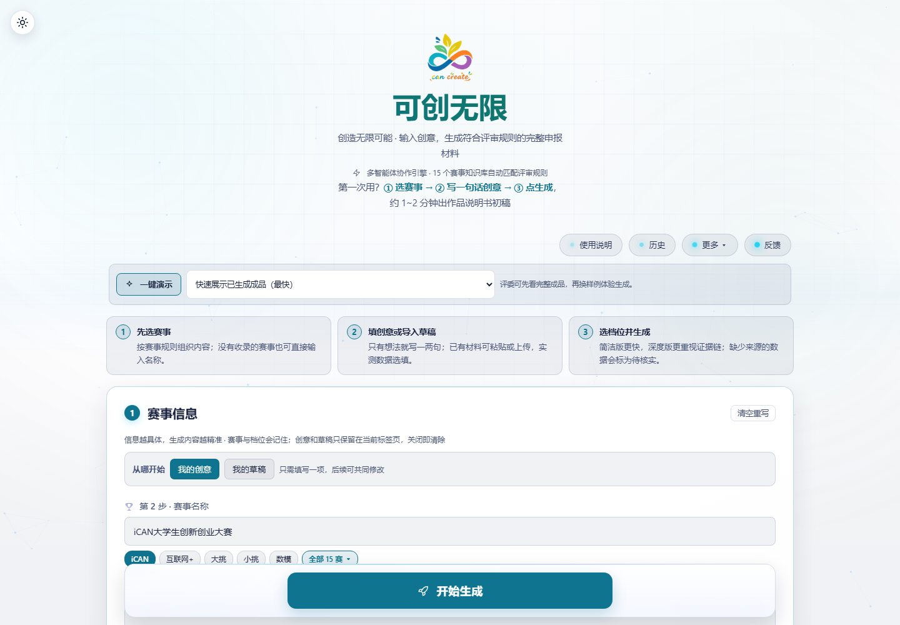
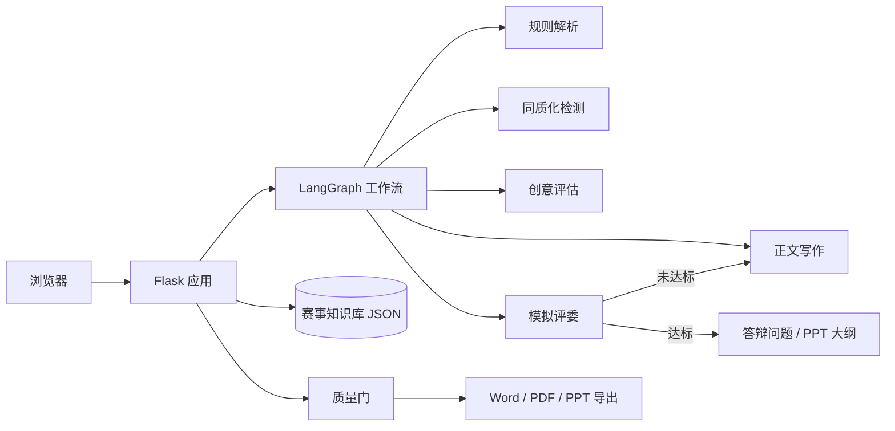

# 可创无限 · 科创赛事多智能体写作助手

面向大学生科创竞赛团队的**申报材料生成系统**。输入赛事名称、一句创意和实测数据，系统按该赛事的官方评审规则自动生成符合格式要求的申报书、答辩问题与 PPT 大纲，并支持导出 Word / PDF / PPT。

在线体验：**[https://kechuang2026.cn](https://kechuang2026.cn)**



---

## 它解决什么问题

科创竞赛的申报书有强规则约束：章节结构、评分权重、字数区间、匿名双盲要求各不相同。团队常见的困境是——创意想清楚了，却写不出「按评分表得分」的材料；找通用大模型代写，产出的内容既不贴赛事规则，还容易出现编造数据、占位符残留、泄露院校姓名等问题，反而在形式审查上失分。

本系统把「赛事规则 → 结构 → 内容 → 质检 → 导出」做成一条流水线：**规则来自官方资料，而不是模型的想象**。

## 核心能力

| 能力 | 说明 |
|---|---|
| 赛事知识库 | 内置 **15 个赛事**的评分标准、章节结构、偏好方向与扣分点（iCAN、互联网+、挑战杯、国创、数学建模、电子设计、蓝桥杯、RoboMaster、服务外包、西门子杯、计算机设计、广告艺术、信息安全、小挑、金砖） |
| 多智能体协同 | 规则解析、创意评估、同质化检测、竞品分析、正文写作、模拟评委评审分节点执行，各节点只写自己的字段 |
| 简洁版 / 深度版 | 简洁版约 1–2 分钟出 2000–4000 字初稿；深度版约 3–5 分钟生成 12000 字级材料，附竞品与商业分析、风险论证、答辩问题、PPT 大纲 |
| 同质化检测 | 对照知识库范文库判断创意与已有获奖作品的重复度，避免选题撞车 |
| 生成质量门 | 导出前自动质检，命中空文档、乱码、占位符残留、编造引用、双盲信息泄露等硬伤则拒绝导出并提示修改 |
| 一键导出 | 申报书（Word / PDF）、PPT 大纲、答辩问题、竞品与商业分析，支持整包导出 |

## 技术架构



- **后端**：Flask + LangGraph，单进程多线程（任务状态保存在进程内，故 `workers` 固定为 1）
- **前端**：原生 JS + CSS，无构建步骤；Service Worker 提供离线壳与静态资源缓存
- **知识库**：结构化 JSON（评分标准 / 章节 / 偏好 / 扣分点）+ 范文库，按赛事加载
- **模型调用**：兼容 OpenAI 协议，通过 `DEEPSEEK_API_KEY` / `CLAUDE_API_KEY` 配置
- **数据**：SQLite 存历史与配额；运行产物统一落在 `backend/.data/`，不入版本库

更细的设计说明见 [`docs/系统架构说明.md`](docs/系统架构说明.md)。

## 目录结构

```
competition-agent
├─ backend/                  后端源码
│  ├─ app.py                 Flask 应用与路由
│  ├─ competition_agents.py  LangGraph 多智能体编排
│  ├─ assets/                内容资产（赛事资料、知识库、训练库）
│  └─ .data/                 运行产物（数据库、上传、生成物，不入库）
├─ frontend/                 前端源码（index.html + static/）
├─ docs/                     设计文档与交付样例（assets/）
├─ scripts/                  索引构建等维护脚本
├─ tests/                    自动化测试与手工探针
├─ app.py / run.py / wsgi.py 入口（根目录同名模块为兼容转发壳）
└─ requirements.txt
```

## 本地运行

```bash
pip install -r requirements.txt
python run.py
# 打开 http://127.0.0.1:8080
```

生产入口使用 WSGI：

```bash
gunicorn wsgi:app --bind 0.0.0.0:$PORT --workers 1 --threads 4 --timeout 600
```

首次运行需配置模型密钥：`DEEPSEEK_API_KEY`（DeepSeek）、`CLAUDE_API_KEY`（火山引擎 Claude）。未配置密钥时页面可浏览，生成接口不可用。

## 测试

```bash
python -m unittest tests.test_repository_layout   # 目录布局与静态资源可访问
python -m unittest tests.test_backend             # 纯函数单元测试（17 项）
python tests/probes/_check_startup.py             # 启动块位置防回归
```

## 文档

| 文档 | 内容 |
|---|---|
| [项目说明](docs/项目说明.md) | 作品定位、功能边界与使用场景 |
| [系统架构说明](docs/系统架构说明.md) | 模块划分、数据流与关键设计取舍 |
| [技术答辩 10 问](docs/技术答辩_10问_标准答案.md) | 常见技术质询与应答 |
| [赛事提交物对照表](docs/赛事提交物对照表.md) | 各赛事要求与系统产出对应关系 |
| [隐私与安全说明](docs/隐私与安全说明.md) | 数据留存、匿名与后台安全措施 |
| [部署说明](docs/部署说明.md) | 部署方式选择与常见故障排查 |
| [交付样例](docs/assets/) | 生成的申报书、答辩问题、说明书、PPT 大纲样例 |

## 许可

MIT License，详见 [LICENSE](LICENSE)。引用或二次开发请保留版权声明。
